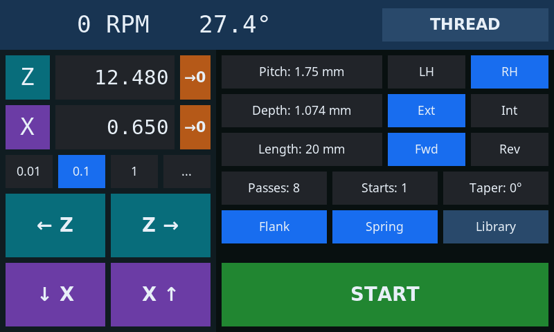
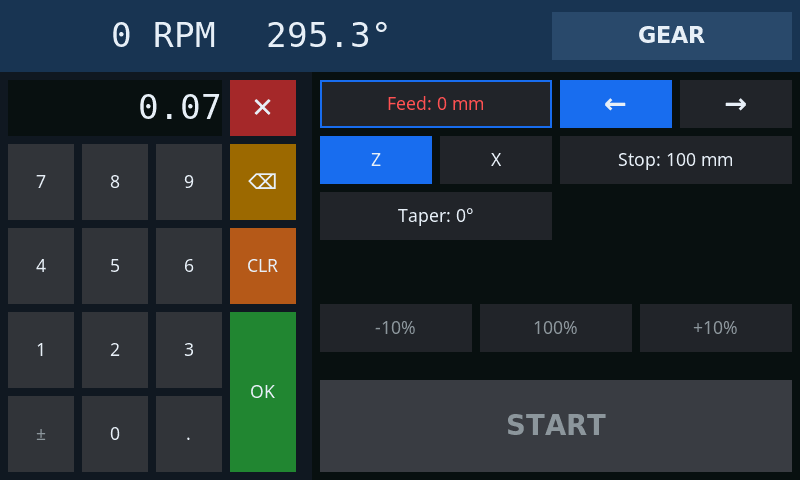
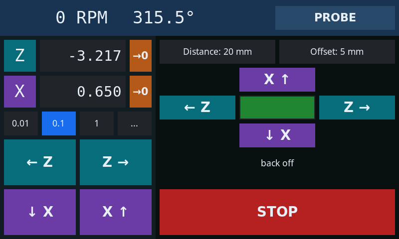
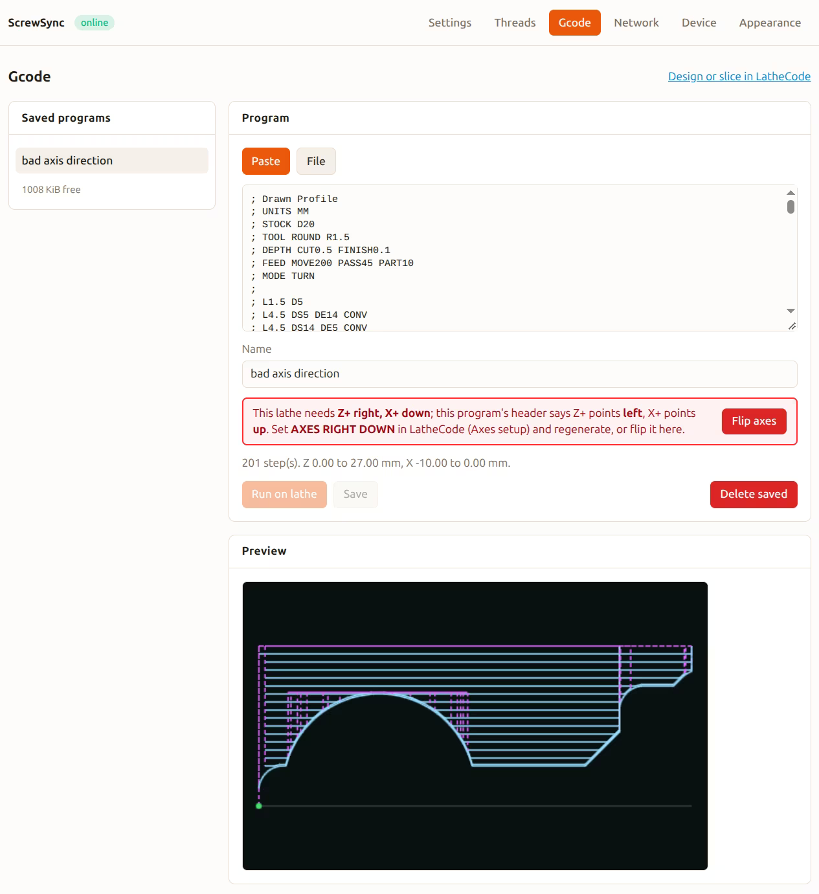
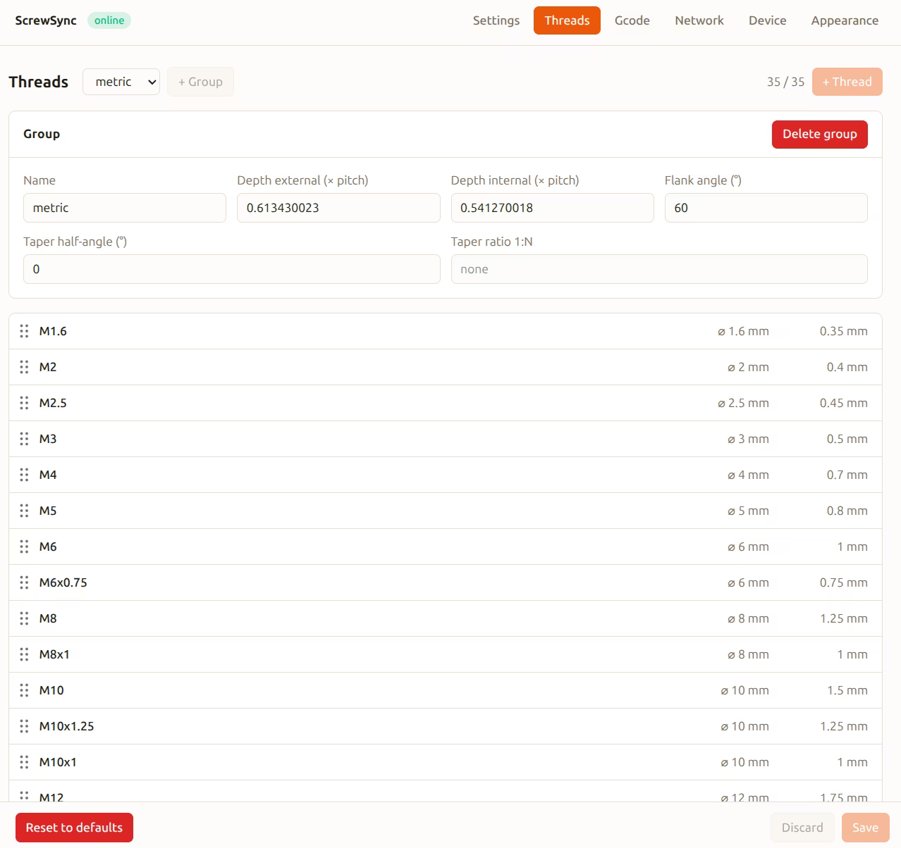

# ScrewSync

A new firmware for the [nanoels H5](https://github.com/kachurovskiy/nanoels)
electronic leadscrew. Same hardware, a touchscreen UI where every control
does one thing.

  
  

*Pick a thread by name and everything fills in. Type numbers on a normal
numpad.*

## Why a new firmware

nanoels is a great piece of hardware, and its firmware packs a lot into one
screen and a PS/2 keyboard. The cost is that buttons change meaning with the
mode, the numpad state and how long you press, and multi-pass jobs are set
up through a step-by-step wizard. ScrewSync keeps the hardware and rebuilds
the rest:

| nanoels                                                     | ScrewSync                                  |
|-------------------------------------------------------------|--------------------------------------------|
| Buttons change meaning by mode and state                    | One control, one job                       |
| Setup wizard for passes, external/internal, taper           | One page per mode, every parameter visible |
| A number typed before a button changes what the button does | Tap a field, type on a numpad              |
| Left/right stops define the job                             | Touch off, type length and depth, start    |
| Pitch and depth entered by hand                             | Thread library by designation              |

## New in ScrewSync

### Probing

Touch off Z or X against a contact plate or a switch probe. ScrewSync
touches, backs off, reprobes slowly and zeroes the axis on the surface.
See [docs/probe.md](docs/probe.md).

### Alternating flank infeed

For threading. Plunging straight in makes both edges of the tool cut at
once, which chatters and tears on deeper threads. With alternating flank
infeed, each pass shifts sideways so only one edge cuts, alternating sides.
A spring pass at full depth finishes the thread.

### And more

- **Spindle direction check**: the job stops if the spindle turns the wrong
  way.
- **Live feed override** while a job runs.
- **G-code** from [LatheCode](https://kachurovskiy.com/lathecode/), with a
  toolpath preview on the web and on the display.
- **Web client** that stays in sync with the display: settings, thread
  table, G-code, backups, logs and firmware updates.

  
  

Gear, async, turn, thread, part, slot and ellipse modes are all there.
Full list: [docs/features.md](docs/features.md).

## Install

It runs on unmodified H5 hardware, but some cables move to other
connectors. See [docs/install.md](docs/install.md).

## Docs

| Doc                            | What                                    |
|--------------------------------|-----------------------------------------|
| [Install](docs/install.md)     | connectors, flashing, first setup       |
| [Features](docs/features.md)   | everything it does                      |
| [Manual](docs/manual.md)       | how to operate it                       |
| [Probe](docs/probe.md)         | probe hardware, settings and cycle      |
| [Design](docs/design.md)       | architecture and machine state          |
| [Protocol](docs/protocol.md)   | command set for serial, display and web |
| [Display](docs/screen.md)      | display UI design and tooling           |

## Credits and license

Built for the [nanoels](https://github.com/kachurovskiy/nanoels) H5 hardware.
ScrewSync is licensed under AGPL-3.0-or-later.

### :heart: If this project is useful to you, consider supporting it

